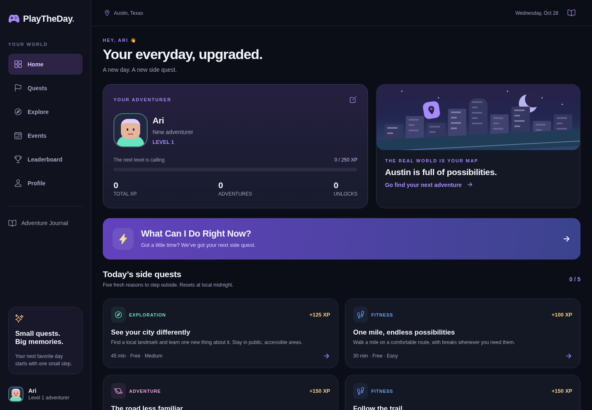
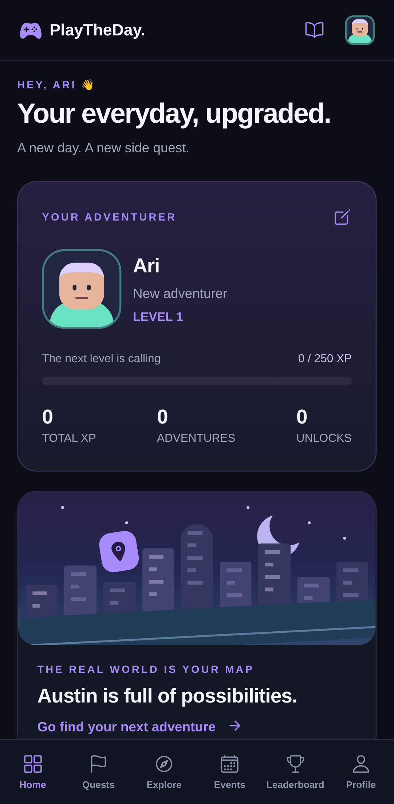

# PlayTheDay

**Turn spare time into a real-world adventure.**

A local-first RPG that helps you find something to do, earn XP, and keep an adventure journal. Built for Android, iOS, and the web with no account required.

**Stack:** React Native · TypeScript · Expo SDK 57 · Expo Router · AsyncStorage · Zod · Playwright



<details>
<summary>View mobile screenshot</summary>



</details>

Screenshots show the web app with a fictional character; mobile uses browser emulation.

## What you can do

- Complete daily quests, earn XP, and unlock avatar items.
- Find activities by time, budget, and distance.
- Choose locations with search, map pins, or optional GPS.
- Complete quests through self-reporting, proximity checks, or photos.
- Save progress and a photo journal on your device.
- Browse source-linked Austin Public Library events when the cache is current.

## Quick start

Install **Node.js 24 LTS**, npm, and Git.

```sh
git clone https://github.com/NukeItGames/PlayTheDay-Portfolio.git
cd PlayTheDay-Portfolio
npm ci
npm run web
```

Open the URL printed by Expo. No API keys or environment file needed.

For mobile, run `npm start` and use Expo Go compatible with SDK 57. For a production web preview, run `npm run export:web` followed by `npm run preview:web`.

**Try it:** Create a character → accept a quest → complete it → open your journal → reload to see your saved progress.

## How it works

`src/game/` holds pure TypeScript game rules. `src/store/` coordinates React state, `src/services/` handles persistence and location, and `src/ui/` renders the screens. Expo Router routes live in `app/`.

Storage updates are serialized and saved before XP is awarded. Recommendations use rules and templates; no AI models are used.

## Tests

```sh
npm run typecheck
npm run lint
npm test
npm run check:expo
npm run export:web
npx playwright install chromium
npm run test:e2e
```

Validated November 12, 2026: **25 unit/integration tests and 16 browser tests passed.** See [validation details](docs/VALIDATION.md).

## Current limitations

- Portfolio MVP; native camera/GPS still needs physical-device testing.
- Event cache has expired. Run `npm run events:refresh`, then reload Expo or rebuild web.
- No cloud sync or backup. Clearing app storage removes progress.
- Maps/search use external services. Photos stay local; photos and check-ins are not independent proof of participation.
- Leaderboard opponents are fictional.

[Development guide](docs/DEVELOPMENT.md) · [Security audit](docs/AUDIT.md) · [Third-party notices](THIRD_PARTY_NOTICES.md) · [MIT license](LICENSE)
